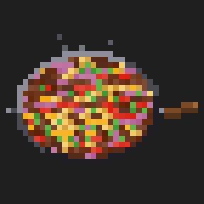
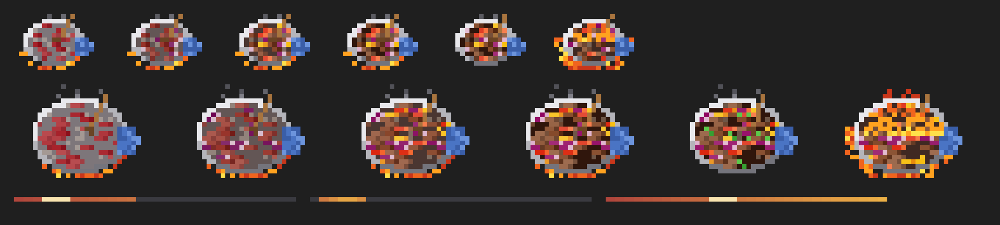

<div align="center">



<h1>Lomo-Saltado</h1>

<p><em>Deja de vigilar a Claude. Que se saltee solo.</em></p>

<p>


</p>

<p>
<a href="#qué-ves">Qué ves</a> ·
<a href="#instalar">Instalar</a> ·
<a href="#cómo-sabe-la-barra">Cómo sabe la barra</a> ·
<a href="#cómo-funciona">Cómo funciona</a> ·
<a href="#preguntas">Preguntas</a>
</p>

</div>

---

> **¿Te quedas mirando la pantalla esperando a que Claude termine?**

Tienes tres terminales de Claude Code. Una refactoriza, otra escribe tests y la tercera acabó hace diez minutos sin que te dieras cuenta. `Lomo-Saltado` le da a cada terminal un nombre, una barra de progreso en vivo y un **lomo saltado que se cocina en la sartén** mientras Claude trabaja. Un comando muestra todas las terminales a la vez.

Es un **mod** de Claude Code (function hooks que dibujan directamente en la interfaz), basado en [`cooked`](https://github.com/Marcelfedz/cooked) de Marcel, que cocina una paella. Aquí cambiamos la paella valenciana por el clásico peruano.

---

## Qué ves

**Encima del prompt, en cada terminal**: su nombre, una barra de progreso, lo que está haciendo ahora mismo y una sartén de lomo saltado en pixel art con fuego y humo:

```
[🍳]   marshall  ━━━━━━━━━━━━━━━━━━━━╸─────────────────  3/7
       ▸ Escribiendo la cocina
       14 ops · 2 ayudantes · 1m 20s · editando register.tsx
       "convierte cooked en un lomo saltado"
```

La sartén se ve desde arriba: acero inoxidable con el borde brillante, una cuchara de madera metida en la salsa del fondo y un trapo azul sobre el mango, con llamas lamiendo el borde. Los ingredientes entran en orden, como en la receta:

1. **El lomo** primero: tiras rojas que se sellan y se vuelven marrones.
2. **La cebolla roja** en gajos, morada por fuera y con su capa blanca por dentro.
3. **El tomate** en gajos y **el ají amarillo** en tiras.
4. **El cilantro**, solo cuando está servido.

Mientras cocina, la sartén **se saltea**: cada segundo y medio la mezcla salta y cae en otro sitio, y la cuchara remueve. Cada pocos segundos viene **el flambeado**: la sartén se prende y las llamas suben por encima de la comida. El jugo (sillao y vinagre) se va juntando oscuro y brillante al fondo.

**Al pie de la banda, la línea de sesión** (en el azul del tema):

```
opus 5.5 · contexto ███░░░░░░░ 34% · ↑1.2M ↓84k tokens · sesión 1h 05m · límite 5h 42%
```

Modelo, cuánto contexto queda (con `casi lleno` desde el 80 %), los tokens gastados en la sesión, cuánto lleva abierta y tus límites de uso (con suscripción) o el coste (con API key).



**`/saltado` abre la cocina**: un panel con todas las terminales de la máquina que usan el mod:

```
Cocina
3 terminales · 2 saltando

marshall  esta terminal
━━━━━━━━━━━━━━━━━━━━━━━━━━━━━━╸─────────────────────  3/7 · 14 ops · 1m 20s
▸ Escribiendo la cocina

api  shop-backend
━━━━━━━━━━━━━━━━━━━━━━━━━━━━━━━━━━━━━━━━━━━━━━━━━━━━  servido en 4m 02s · 61 ops

tests  shop-frontend
━━━━━━━━━━━━━━━━━━━━━━━━━━━━━━━━━━━━━━━━━━━━━━━━━━━━  9 ops · 0m 41s
▸ $ npm test
```

`/saltado nombre api` renombra la terminal en la que estás. Por defecto se llama como la carpeta del proyecto.

**Cuando termina un turno**: una notificación con el nombre de la terminal y **¡Saltado!**. Un banner si duró menos de 2 minutos, una alerta que hay que cerrar si duró más, con lo que pediste, las carpetas tocadas y las herramientas usadas. ✅ o ❌ según si falló alguna herramienta.

---

## Instalar

Desde el prompt de Claude Code:

```
/plugin install saltado --marketplace mbaudran/Lomo-Saltado-Claude-mod
```

O desde una terminal:

```bash
claude plugin marketplace add mbaudran/Lomo-Saltado-Claude-mod
claude plugin install saltado@lomo-saltado
```

O con el instalador:

```bash
curl -fsSL https://raw.githubusercontent.com/mbaudran/Lomo-Saltado-Claude-mod/main/install.sh | bash
```

Necesita una versión de Claude Code con mods de function hooks. Probado en 2.1.303.

---

## Cómo sabe la barra

Claude Code no sabe cuánto va a tardar una tarea, así que un porcentaje por tiempo sería inventado. `Lomo-Saltado` no se lo inventa.

- **Si Claude lleva una lista de tareas** (`TodoWrite`, o `TaskCreate` / `TaskUpdate`), la barra es la parte real de pasos hechos, `3/7`, y la línea de abajo es el paso en curso.
- **Si no lleva ninguna**, la banda dice `sin lista de tareas` y la barra es un pulso que recorre la pista: vivo, pero sin afirmar nada. La línea de abajo dice qué hizo la última herramienta (`$ npm test`, `editando register.tsx`, `mandando a un ayudante: Explora el repo`).

El mod no pide a Claude que haga ninguna lista: no añade herramientas ni texto al prompt, así que cuesta **cero tokens extra**. Solo lee lo que Claude hace de todas formas.

La sartén es decoración y puede adivinar: sin plan se cocina despacio con el tiempo, y nunca se sirve antes de que termine el turno.

---

## Cómo funciona

Un módulo de hooks, `saltado/hooks/register.tsx`, sobre la API de mods:

| Evento | Qué hace |
|---|---|
| `turn.start` | Un plato nuevo: el prompt, la hora de inicio, contadores a cero. El turno de un subagente cuenta como ayudante. |
| `tool.call` | Cuenta la operación, describe la actividad, apunta los archivos editados; tras `TodoWrite` / `TaskCreate` / `TaskUpdate`, actualiza el plan. Nunca bloquea una llamada. |
| `turn.complete` | Lo marca como servido, suma los tokens del turno y manda la notificación. |
| `ui.render` `AbovePrompt` | Dibuja la banda. La sartén y las barras son celdas `Raster` (pixel art con medios bloques), animadas con `$.ui.blit`. |
| `ui.render` `Pane` | Dibuja la cocina. |
| `command.run` `saltado` | Abre o cierra la cocina; `nombre` renombra la terminal. |

El estado vive en `$.state`, así que recargar el mod no lo pierde. Para la cocina, cada sesión escribe un JSON pequeño en `~/.claude/saltado/cocina/<session-id>.json` (latido cada 15 s, se borra al cerrar la sesión, los de más de 12 h se limpian). Nada sale de tu máquina.

**Con Keloqz.** Si tienes abierto **Keloqz**, el pastor alemán de escritorio, él mismo anuncia el **¡Saltado!** y el mod no manda el banner de macOS. Keloqz escribe su latido en `~/.claude/saltado/keloqz.json` cada 10 s; mientras tenga menos de 30 s y su proceso siga vivo, el mod se calla (también si Keloqz está silenciado). Si cierras Keloqz, los banners vuelven solos. Cada fila de la cocina lleva además `aborted`, para que Keloqz tampoco avise de los turnos parados con Esc.

El dibujo está en `saltado/hooks/wok.ts`, con funciones puras (la receta visual sigue una foto de un lomo saltado en sartén). `node --experimental-strip-types tools/saltado-preview.ts saltado/assets/wok.png` lo renderiza a PNG (y el icono a `icon.png`) para ajustar la receta.

Tests: `claude plugin test saltado`.

---

## Preguntas

**¿Es seguro?**
Sí. Todo el código está en este repo. Cuenta llamadas a herramientas, mide turnos, escribe un JSON por sesión abierta en `~/.claude/saltado/` y muestra notificaciones de macOS o Linux. No envía datos a ningún sitio.

**¿Hace más lento a Claude?**
No. Una llamada a herramienta cuesta un par de escrituras de estado en memoria. La animación repinta unas decenas de celdas a unos siete fotogramas por segundo, solo mientras algo se cocina o la cocina está abierta.

**¿Puedo ocultar la banda?**
`ctrl+x ctrl+a` (o el `[-]` a su lado) la pliega, como cualquier banda encima del prompt.

**¿Funciona fuera de la terminal?**
La app de escritorio dibuja la misma banda y cocina con barras de texto (no tiene celdas de píxeles, así que no hay sartén). Las notificaciones usan macOS primero, `notify-send` en Linux y el canal propio de Claude Code en el resto.

**¿Por qué lomo saltado?**
Porque se hace a fuego vivo, rápido y con flambeado, como un buen turno de Claude. Y porque cuando termina, está *saltado*.

---

## Configuración

| Variable | Por defecto | Qué hace |
|---|---|---|
| `SALTADO_ALERT_THRESHOLD` | `120` | Segundos. Los turnos más largos dan una alerta fija en vez de un banner. |
| `SALTADO_NOTIFY` | on | `off` silencia las notificaciones; la banda y la cocina siguen. |
| `SALTADO_REPO` | `mbaudran/Lomo-Saltado-Claude-mod` | El repo del que tira `install.sh` (para forks). |

**Icono en el banner (opcional, macOS).** Con [terminal-notifier](https://github.com/julienXX/terminal-notifier) instalado (`brew install terminal-notifier`), los banners llevan el icono de la sartén.

---

## Desinstalar

```bash
claude plugin uninstall saltado
claude plugin marketplace remove lomo-saltado
rm -rf ~/.claude/saltado
```

O `bash ~/.claude/plugins/marketplaces/lomo-saltado/uninstall.sh` si lo instalaste con `install.sh`.

---

## Créditos y licencia

Basado en [`cooked`](https://github.com/Marcelfedz/cooked) de Marcel (MIT): la banda, la cocina, las barras y las notificaciones son suyas; la sartén, la receta y el castellano son de aquí. MIT, ver [`LICENSE`](./LICENSE).
